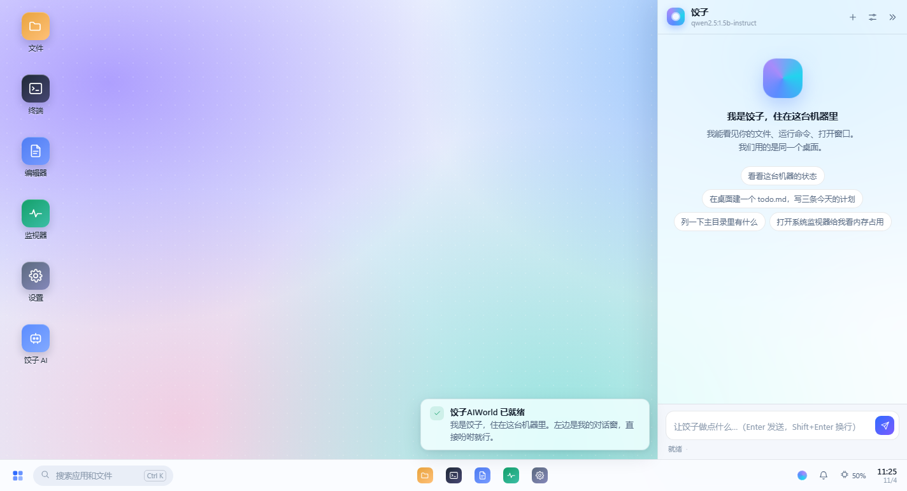
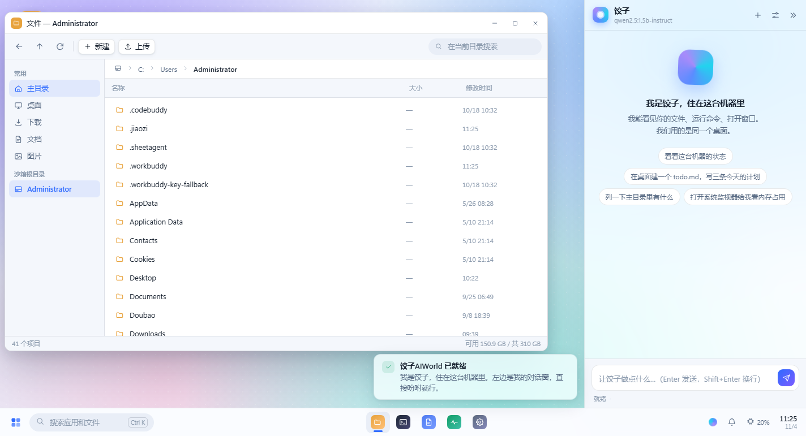
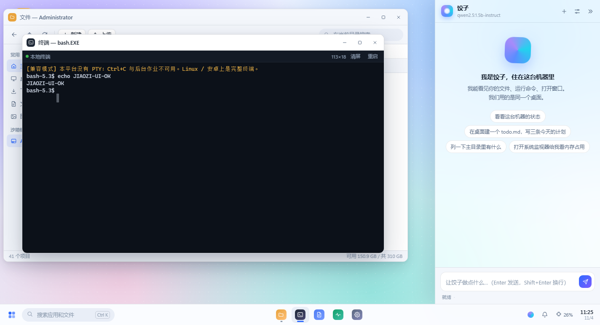
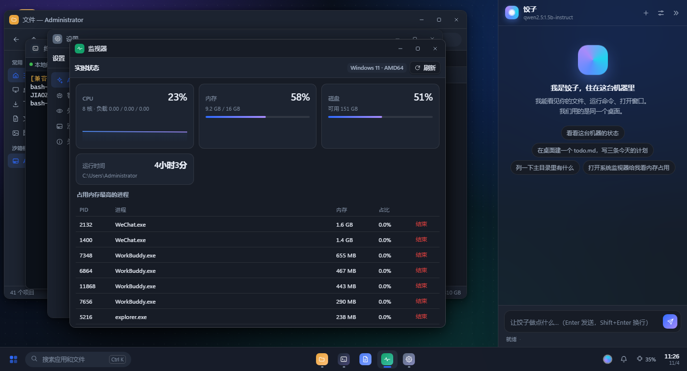
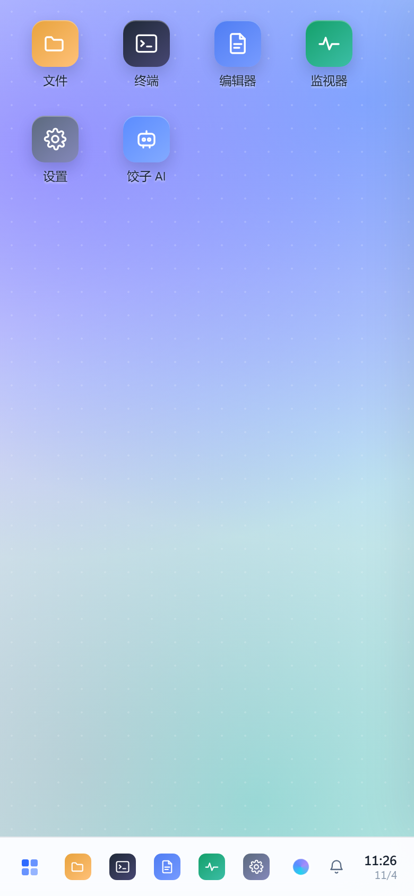
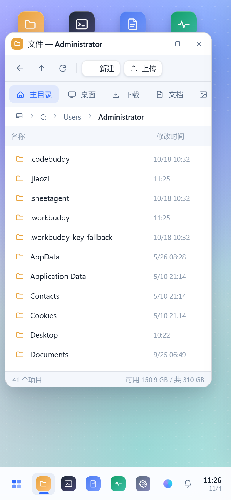
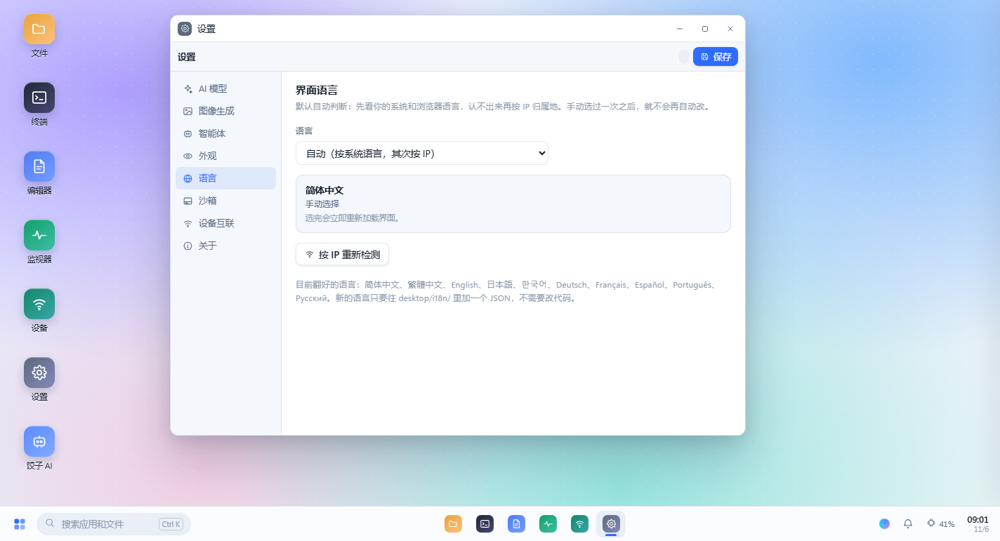

# JiaoziAIWorld

**A Windows-like desktop for Linux, shared by a human and an AI.**
One codebase, running on PCs, Android phones, and boards like Raspberry Pi / RK3588. The model can run entirely on-device — it keeps working offline.

[简体中文](README.md) · English



> What we are after is simple: **let people, computers, phones, robots and devices run models themselves.**
> Not "send a request to someone's cloud and wait for a sentence back", but putting the brain *inside* the device —
> so a robot can look and act on its own, and a machine with no network is still a machine that gets work done.
> Nobody finishes this alone. The code is fully open source. **Contributions are welcome.**

---

## What this is (and why it is not another chat wrapper)

Most "AI + Linux" setups are two separate things glued together: an operating system on one side, a chat window on the other. The human and the AI each work alone, and the AI can only hand you back text that you then have to run yourself.

JiaoziAIWorld takes a different angle: **the desktop itself is the AI's interface.**

- Humans and apps drive the desktop over HTTP/SSE;
- The AI drives the desktop through **the very same endpoints**;
- So a window the AI opens is a window you can see, a file the AI edits shows up in your file manager immediately, and a command the AI runs appears in your notifications;
- Conversely, when you edit a file by hand, the AI reads the new content on its next turn — no syncing, no uploading, no "two worlds".

One key technical decision: **no X11 / Wayland — the browser engine is the renderer.**
The reasoning is practical. X11 on Android means wrestling with proot + chroot; on a board it means a pile of drivers, and the UI collapses the moment the resolution changes. Chromium already runs well on all three, and it gives you "phone connects to the same desktop" for free.
The trade-off: this is not a desktop that runs Photoshop. It is a **device console and an AI work surface**, not a GNOME replacement.

---

## Up and running in 30 seconds

Only Python 3.8+ standard library. **No pip install, no npm install, no build step.**

```bash
git clone <this repo> && cd jiaozi-aiworld
python3 -m jiaozi --open
```

Your browser opens `http://127.0.0.1:8787/` — that is the desktop in the screenshot.

### Desktop (Linux / macOS)

```bash
./scripts/install.sh            # launcher + desktop entry
jiaozi --open                   # start it this way from now on
./scripts/install.sh --service  # optional: systemd service on boot
```

Windows works too (preview tier — the terminal uses pipes instead of a PTY):

```powershell
python -m jiaozi --open
```

### Android phone

No root, no proot — the core is pure Python:

```bash
# Install Termux (F-Droid build), copy the project over, then:
bash scripts/android-termux.sh /path/to/jiaozi-aiworld
```

Open `http://127.0.0.1:8787/` and choose "Add to home screen" — it feels like a native full-screen app.
Termux has a real PTY, so the terminal is fully usable.

### Boards (Raspberry Pi / Orange Pi / RK3588)

```bash
sudo apt install -y python3 chromium
./scripts/install.sh --kiosk --service
jiaozi-kiosk        # full-screen, plug in a screen and it is an appliance
```

HDMI display plus a touch panel, and it boots straight into the desktop. See [docs/DEVBOARD.md](docs/DEVBOARD.md) (Chinese).

### Share it on the LAN (phone and PC, one desktop)

```bash
python3 -m jiaozi --host 0.0.0.0
```

On startup it prints a phone-ready URL carrying a token. What the phone sees is **the same desktop**: the same files, the same AI conversation, the same window events. Ask the assistant on your phone to tidy up photos and watch it happen on the PC.

---

## What is on the desktop

| App | What it does |
|---|---|
| **Files** | Tree, breadcrumbs, search, upload/download, drag-and-drop, rename, delete to trash, live-follows AI edits |
| **Terminal** | Hand-written VT parser (256 colour / truecolor / cursor control / wide chars); real PTY on POSIX; reconnects and backfills output |
| **Editor** | Line numbers, monospace, Ctrl+S, dirty marker, line list |
| **System monitor** | Live CPU/memory/disk curves, process table, kill process |
| **Settings** | Model endpoint, **image generation**, approval policy, theme/wallpaper, sandbox root, language — applied immediately |
| **Image viewer** | Zoom, fit-to-window, open externally; open a folder and it becomes an album with paging |
| **Jiaozi AI** | Docked right panel: streaming replies, tool-step cards (finished images shown as thumbnails), approval for dangerous operations |

The window manager is ours: drag, eight-way resize, edge snapping, maximise, stacking, taskbar switching, context menus. Light/dark themes, five wallpapers, all plain CSS.

<table>
<tr><td></td><td></td></tr>
<tr><td></td><td></td></tr>
</table>

The phone runs the same code, not a separate app: the narrow layout switches to a four-column icon grid, the file manager sidebar collapses into a top shortcut row, and the AI panel goes full screen with a "Desktop" button to get out. This is the file manager on a 390×844 viewport (open devtools and try it yourself):

<p align="center"></p>

---

## Speaks your language

The UI ships with **10 languages**: 简体中文, 繁體中文, English, 日本語, 한국어, Deutsch, Français, Español, Português, Русский.

Language resolution has an explicit priority order, and the UI tells you which rule won (Settings → Language):

1. **Your own choice** — stored in the browser, always wins;
2. **Browser/OS language** — `Accept-Language`, sorted by q-value, first one we support;
3. **IP location** — when the first two do not match, resolve the egress IP via [api.ip.sb](https://api.ip.sb/geoip/) (falling back to `ipwho.is`, then `ipinfo.io`) and map country to language;
4. English if all else fails.

Step 3 runs **after first paint**, so it never slows down startup. It reloads only when the answer differs, and marks the session in `sessionStorage` so "detect → reload → detect again" cannot loop. When a phone reaches your PC over the LAN the peer address is `192.168.x.x`, so we look up **the server's own egress IP** instead — a private address says nothing about where you are.



Dictionaries are standalone JSON files. Adding a language = drop in one file + add one line to `LANGS` in `jiaozi/i18n.py`:

```json
// jiaozi/desktop/i18n/de.json
{
  "code": "de",
  "name": "Deutsch",
  "strings": {
    "文件": "Dateien",
    "终端": "Terminal",
    "{n} 分钟前": "vor {n} Min."
  }
}
```

**The key is the original Chinese string** — no invented names like `app.files.title`. The source is written in Chinese, so using the original text as the key means a translation file can be read and filled in without opening a single line of code, and a missing entry still falls back instead of rendering blank.

Three-level fallback: current language → English → original Chinese. Placeholders such as `{n}` and `{name}` must match on both sides; that, plus "is this key still used in the source" (orphan detection), is checked mechanically by `tools/i18n_check.py`:

```bash
python3 tools/i18n_check.py           # check + print coverage
python3 tools/i18n_check.py --strict  # fail below the threshold (50% by default); run before a release
```

| Language | Coverage |
|---|---|
| `en` | 100% |
| `zh-TW` `ja` `ko` `de` `fr` `es` `pt-BR` `ru` | ~51% (all core UI; long explanatory prose falls back to English) |

**Translations are very welcome**: open `jiaozi/desktop/i18n/*.json`, fill in what is missing under `strings`, run `i18n_check.py` until it is clean, and send a PR. No code reading required.

---

## What the AI can actually do

Not "it can chat" — **it can act**. Thirteen built-in tools, all going through the same backend endpoints a human uses:

| Tool | Purpose | Dangerous |
|---|---|---|
| `fs_list` `fs_read` `fs_search` | List, read, search by name | |
| `fs_write` `fs_mkdir` | Write files, create directories | |
| `shell_run` | Run shell commands | ⚠ |
| `sys_info` `proc_list` `proc_kill` | System info, processes, kill | ⚠ |
| `ui_open` | Open a window or file on the human's desktop | |
| `ui_notify` | Post a notification | |
| `image_gen` | **Call a text-to-image model; the image lands on disk as a real file** | |
| `web_fetch` | Fetch and extract page text | ⚠ |

### It draws, and what it draws are real files

`image_gen` does not stuff a bitmap into the chat window — it **calls a text-to-image model and writes a PNG to disk**, returns the path, and then uses `ui_open` to show it in your image viewer.

That design is aimed at robots: a board has no browser and nobody watching the screen. An image has to be a file so another program can consume it — print it, upload it, put it on a display, feed it to a vision model.

```
You:   draw two portraits, one in a qipao in a garden, one in denim on the street
Jiaozi: image_gen (43 s) → two 832×1248 PNGs
        → thumbnails appear in the conversation (click to enlarge)
        → ui_open(app="viewer", path=...) opens them on your desktop
```

Configuration is one OpenAI-compatible image endpoint:

```json
"image": {
  "base_url": "https://apihub.agnes-ai.com/v1",
  "model": "agnes-image-2.5-flash",
  "api_key": "sk-...",
  "size": "1024x1024"
}
```

Leave `base_url` / `api_key` empty to reuse the `llm` settings — if your gateway serves both, you configure it once. A local Stable Diffusion works too, as long as it exposes `/v1/images/generations`.

Three design notes worth calling out:

**1. Small models work.** Many 1B–3B models do not support OpenAI's `tools` parameter. We speak both protocols: native function calling when available, otherwise a prompt protocol (the model emits a ```json {"tool": ...}``` block that the server parses). If the model errors out with "tools not supported", we switch and retry once — invisible to the user.

**2. Dangerous operations need a human.** Three policies: `auto` (ask only for dangerous ones), `always`, `never`. The approval card appears inline in the conversation, showing the full command; nothing runs until you allow it. Approving the same tool once in a session stops the nagging.

**3. Context is kept small.** Only the last 14–24 messages, tool results truncated past 3000 characters. A 1.5B model with a 4K window still survives multi-step tasks.

Point it at a model (local Ollama shown):

```bash
./scripts/get-model.sh qwen2.5:1.5b-instruct
# then Settings → AI model → http://127.0.0.1:11434/v1
```

Recommended tiers: [docs/MODELS.md](docs/MODELS.md) (Chinese).

---

## Using it as a robot / device brain

This is the real ambition of the project: **give a brainless device a local brain.**

```bash
# The device side only needs to send one sentence and take the result
curl -X POST http://127.0.0.1:8787/api/device/task \
  -H 'Content-Type: application/json' \
  -d '{"prompt":"Check free disk space; if below 10% clean old logs in /tmp","device":"arm-bot-01"}'
```

```json
{"ok": true, "result": "15.2% free, no cleanup needed.", "steps": 2, "elapsed": 3.4}
```

The only requirement on the device is the ability to make an HTTP request. Model, tools, approvals and logs all live on the board. An RK3588 with 8 GB RAM running a 1.5B model plus this service draws around ten-odd watts and works offline. Out of compute? Chain two machines: one runs the model as the "brain", one runs the desktop and peripherals as the "body", talking over the same API.

### LAN peering: several machines, one hand

Instances on the same Wi-Fi see each other (UDP multicast, every 5 seconds). Pairing needs no IPs and no passwords: hit "Generate pairing code" on one machine, type the 6 digits on the other, and tools can cross devices.

After pairing the AI gains two tools:

| Tool | Purpose |
|---|---|
| `peer_list` | List known devices on the LAN, online state, capabilities |
| `peer_call` | Run any tool on a named device (read files, run commands, open windows) |

So "tell your phone to make your PC work" stops being a metaphor:

```
You (to the phone): check the report on the living-room PC's desktop and read me the conclusion
Jiaozi (phone):    peer_list → finds "living-room PC"
                   peer_call(device="living-room PC", tool="fs_list", args={"path":"~/Desktop"})
                   peer_call(device="living-room PC", tool="fs_read", args={"path":".../report.md"})
                   → reads it to you
```

The safety boundary sits in three places:

- Pairing codes are **one-shot**, expire in 5 minutes, and burn after 6 wrong attempts;
- Cross-device calls use the target machine's own token, **not** a master key;
- `peer_call` is on the approval list, so `approval=auto` still asks you first.

If public Wi-Fi blocks multicast nothing breaks: IP plus pairing code still connects, only auto-discovery stays empty.

---

## Project layout

```
jiaozi-aiworld/
├── jiaozi/
│   ├── server.py         HTTP core: routing, SSE, static files, auth (stdlib only)
│   ├── shell.py          PTY / pipe session management + ring buffer
│   ├── fsapi.py          Sandboxed filesystem (out-of-bounds is rejected)
│   ├── sysinfo.py        CPU/memory/disk/processes (/proc on Linux, degraded fallback on Windows)
│   ├── config.py         Config and runtime paths
│   ├── eventbus.py       In-process event bus (SSE fan-out)
│   ├── geo.py            Egress IP → country/city (three providers in order, 6h disk cache)
│   ├── i18n.py           Language resolution: user > Accept-Language > IP > default
│   ├── peer.py           LAN peering: multicast discovery, pairing codes, cross-device calls
│   ├── agent/
│   │   ├── llm.py        OpenAI-compatible client (streaming + tool_calls delta assembly + proxy bypass)
│   │   ├── tools.py      15 tool definitions and dispatch
│   │   ├── loop.py       Agent loop, dual protocol, approvals, context trimming
│   │   └── prompts.py    Prompts
│   └── desktop/          Frontend (no framework, no build)
│       ├── index.html
│       ├── css/          base / desktop / apps
│       ├── i18n/         10 dictionaries (keys are the Chinese source strings)
│       └── js/
│           ├── core.js     API, SSE, toast, modal, context menu, Markdown
│           ├── i18n.js     Translation core, switching, IP refinement
│           ├── vt.js       VT screen buffer and parser (unit-testable on its own)
│           ├── wm.js       Window manager
│           ├── shell.js    Desktop shell: icons / taskbar / start menu / notifications
│           ├── agent.js    AI panel
│           └── apps/       7 built-in apps (including "Devices")
├── scripts/              Install, Android, kiosk, models
├── tests/                Smoke, VT unit, UI E2E, peering E2E
├── tools/                i18n_check.py (dictionary validation and coverage)
└── docs/                 Architecture, install, board, API, models
```

---

## How far it has been verified

These are not "write it and ship it". The repo carries four self-running suites, all currently green:

```bash
python3 tests/smoke_test.py     # 58: HTTP, sandbox, terminal, agent loop, approval, device, image, auth, keep-alive
node tests/vt_test.js           # 24: VT parsing, colour, cursor, wide chars, HTML escaping
python3 tests/ui_test.py        # 67: real browser, real keydown, device pairing, phone portrait, i18n, screenshots
python3 tests/peer_test.py      # 40: two real processes discovering, pairing, cross-device exec, identity across restart
python3 tests/image_e2e.py      # 8: real model + real browser, the AI actually draws two images (costs quota, run separately)
python3 tools/i18n_check.py     # 9 dictionaries: parseable, no orphans, placeholders match, coverage
```

**197 assertions** plus mechanical validation of 9 dictionaries. The first four cost nothing and need no network, so they can go straight into CI; `image_e2e.py` really calls an image model and is kept separate.

`smoke_test.py` embeds a fake OpenAI-compatible model server, so **the full agent path is verified without a real model**: the "model" asks for `fs_list`, the server really lists a directory, feeds it back, and the "model" produces a final answer. Approvals are real too — the test receives the approval event over SSE and posts an HTTP approval before the command executes. The last block temporarily disables localhost bypass to check the phone-over-the-network path: no credentials rejected, wrong token rejected, `?token=` trades for a cookie, cookie accepted. That is the difference between "phone can connect to PC" and "phone cannot", and it is not something to guess about.

`ui_test.py` drives headless Chrome through a 200-line CDP client: real navigation, real `keydown`, real screenshots. The `echo JIAOZI-UI-OK` in the terminal is typed through exactly the same keyboard path a user takes. The final block switches the viewport to 390×844 and measures again: is the first screen the desktop, is there horizontal overflow, does any window leave the screen, is the filename still visible, did the terminal recompute its columns. A later block switches to German and asserts that the button text really changed, that title and placeholder attributes were translated too, that a missing key falls back instead of blanking out, and that a 404 dictionary does not produce a white screen.

These tests are not decoration — they have caught real bugs (see the end of `docs/ARCHITECTURE.md`).

**Verified:** service on Linux/Windows, sandbox escape rejection, PTY and pipe terminals, dual-protocol agent, approval blocking, dark theme, window drag/resize/maximise, 8 apps, phone/PC same-origin access, phone portrait layout, 10-language switching.

**Not yet verified (needs your hardware):** retail Android devices, Raspberry Pi / RK3588 boards, multi-step task success rates with real small models, touch gestures, stability beyond 24 hours. I will not claim those "definitely work"; the docs state the expectations and the risks.

---

## Boundaries and trade-offs

- **Not a general-purpose Linux desktop.** GIMP/IDE-class X11 applications will not run. It is a device console.
- **A browser engine is a hard dependency.** The board needs Chromium (~100 MB).
- **The security model is plain.** Single token plus directory allow-list, plaintext HTTP. It is built for a trusted LAN or a single machine — do not expose it to the public internet as-is.
- **Full-screen TUIs are limited.** The VT implementation has no scroll regions or mouse reporting, so vim/htop will look wrong; bash, logs and build output are fine.
- **Windows is a preview tier.** The terminal uses pipes, no job control.

---

## Roadmap

- [ ] Touch gestures (long-press menu, pinch zoom)
- [ ] Persist window positions across restarts
- [ ] Cross-device sessions: AI on the phone driving windows on the PC
- [ ] Voice entry (local whisper.cpp + streaming TTS)
- [ ] Skill packs: turn recurring tasks into reusable scripts the AI can call
- [ ] One-shot board images (Raspberry Pi / RK3588)

---

## License

MIT. Take it, change it, put it in your robot.

If it saves you one cloud call, or one afternoon of flying blind with no network, the project paid for itself.
