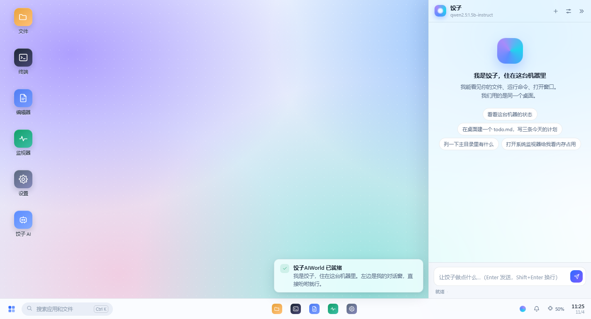
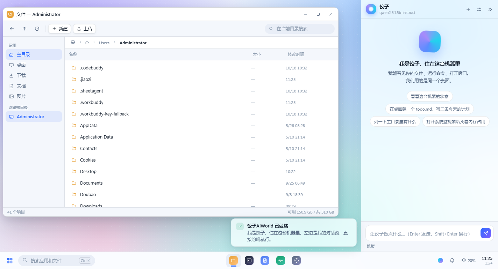
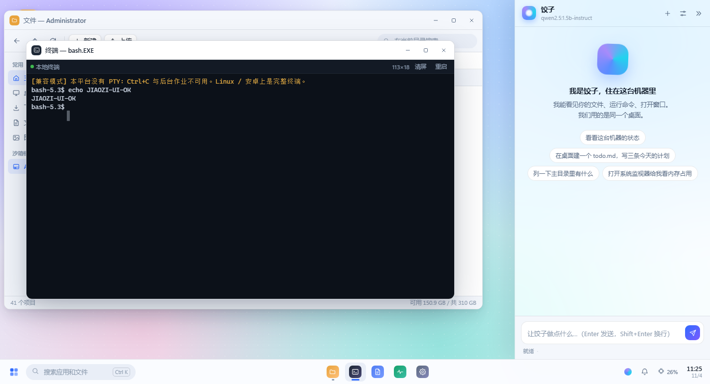
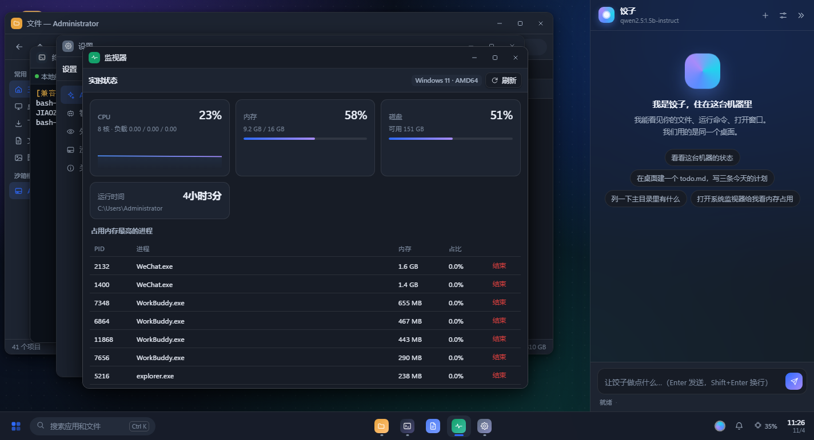
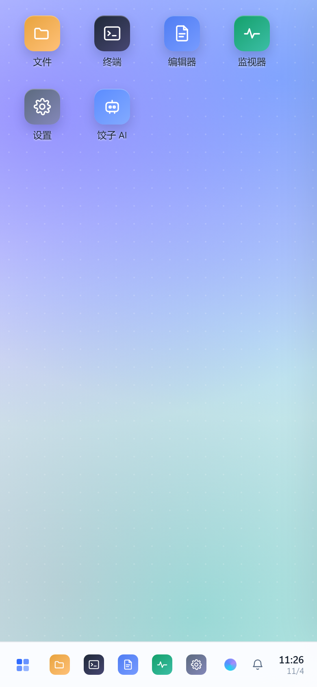
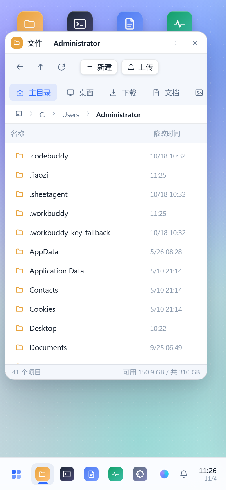
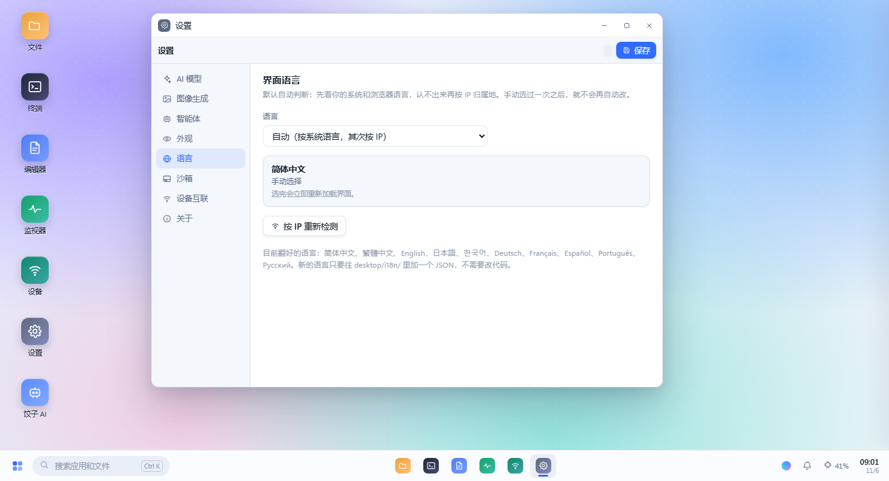
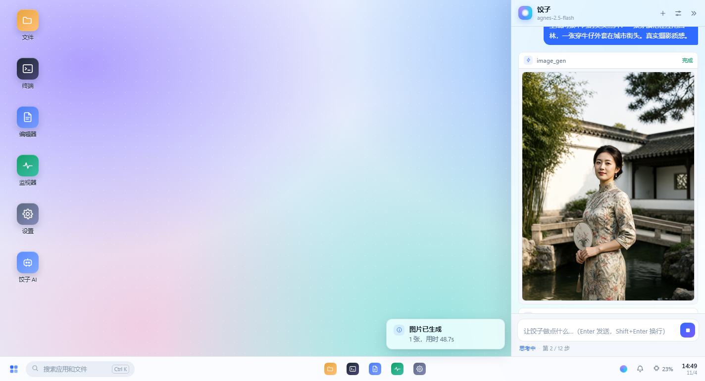
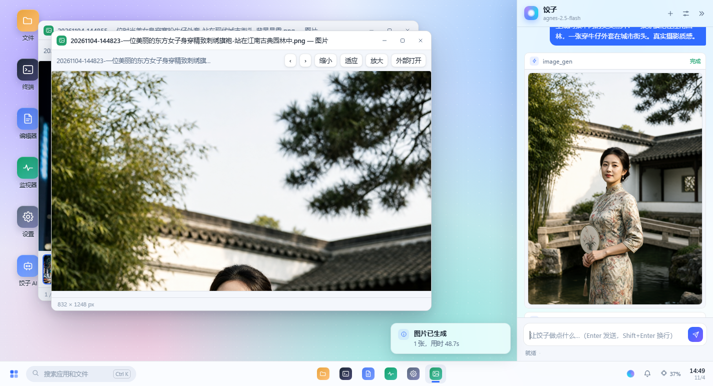

# 饺子AIWorld

**给 Linux 加一个像 Windows 一样的桌面，人和 AI 共用同一张桌子。**
同一套代码跑在电脑、安卓手机、树莓派 / RK3588 这类开发板上；模型可以完全跑在本地，断网也能干活。

简体中文 · [English](README.en.md)



> 我们想做的事很简单：**让人、电脑、手机、机器人、各种设备都能自己跑模型。**
> 不是把请求发到某朵云上再等一句话回来，而是把"脑子"装进设备里——
> 机器人能自己看、自己动手，设备断了网也还是个能干活的设备。
> 这条路一个人走不完，代码全部开源，**欢迎一起开发**。

---

## 这是什么，为什么不是"又一个套壳"

大多数"AI + Linux"方案是两套东西拼起来：一边是操作系统，一边是一个聊天窗口。人和 AI 各干各的，AI 只能给你返回一段文字，你还得自己去终端里执行。

饺子AIWorld 换个思路：**桌面本身就是 AI 的操作界面**。

- 人类和应用通过 HTTP/SSE 操作桌面；
- AI 通过**同一批接口**操作桌面；
- 所以 AI 打开的窗口你看得见，AI 改的文件你在文件管理器里立刻看到，AI 执行的命令会出现在通知里；
- 反过来，你手动改了文件，AI 下一轮读到的就是新内容——不需要同步、不需要上传、没有"两个世界"。

技术上做了一个关键的取舍：**不用 X11 / Wayland 那一套，用浏览器内核做渲染层**。
理由很实际：X11 在安卓上要靠 proot+chroot 折腾，在开发板上要装一堆驱动，分辨率一变 UI 就崩。
而 Chromium 在这三类设备上都已经跑得很好，还能天然支持"手机远程连同一个桌面"。
代价是它不是一个能跑 Photoshop 的传统桌面——它的定位是**设备控制台 + AI 工作面**，不是替代 GNOME。

---

## 30 秒跑起来

只依赖 Python 3.8+ 标准库。**没有 pip install，没有 npm install，没有构建步骤。**

```bash
git clone https://github.com/highzo/jiaozi-aiworld && cd jiaozi-aiworld
python3 -m jiaozi --open
```

浏览器会打开 `http://127.0.0.1:8787/`，就是上面那张桌面。

### 电脑（Linux / macOS）

```bash
./scripts/install.sh            # 装启动器和桌面图标
jiaozi --open                   # 以后直接这样启动
./scripts/install.sh --service  # 可选：systemd 开机自启
```

Windows 也能跑（开发预览用，终端走管道而非 PTY）：

```powershell
python -m jiaozi --open
```

### 安卓手机

不需要 root，不需要 proot，核心就是纯 Python：

```bash
# 手机装 Termux（F-Droid 版）→ 把项目目录传进去
bash scripts/android-termux.sh /path/to/jiaozi-aiworld
```

然后手机浏览器打开 `http://127.0.0.1:8787/`，菜单里"添加到主屏幕"，就是全屏 App 的感觉。
Termux 里有真 PTY，所以终端是完整可用的。

### 开发板（树莓派 / Orange Pi / RK3588）

```bash
sudo apt install -y python3 chromium
./scripts/install.sh --kiosk --service
jiaozi-kiosk        # 全屏独占，接上屏幕就是一台设备
```

接 HDMI 屏 + 触摸屏，开机直接进桌面。详见 [docs/DEVBOARD.md](docs/DEVBOARD.md)。

### 局域网共享（手机 + 电脑同一个桌面）

```bash
python3 -m jiaozi --host 0.0.0.0
```

启动时会打印一个带 token 的手机访问地址。手机打开后看到的是**同一个桌面**：
同一份文件、同一个 AI 会话、同一批窗口事件。手机上让饺子整理照片，电脑上立刻能看到。

---

## 桌面上有什么

| 应用 | 说明 |
|---|---|
| **文件管理器** | 目录树、面包屑、搜索、上传/下载、拖拽上传、重命名、删除进回收站、实时跟随 AI 的文件改动 |
| **终端** | 自研 VT 解析器（256 色/真彩/光标控制/宽字符），POSIX 上是真 PTY，断线重连自动补齐输出 |
| **编辑器** | 行号、语法等宽、Ctrl+S、脏标记、行列表统计 |
| **系统监视器** | CPU/内存/磁盘实时曲线、进程表、结束进程 |
| **设置** | 模型端点、**图像生成**、审批策略、主题壁纸、沙箱根目录，改完立即生效 |
| **图片查看器** | 缩放、适应窗口、外部打开；直接打开一个目录就是相册，可左右翻页 |
| **饺子 AI** | 右侧常驻面板：流式回复、工具步骤卡片（画完的图直接显示缩略图）、危险操作审批 |

窗口管理器是自己写的：拖拽、八向缩放、贴边分屏、最大化、层叠、任务栏切换、右键菜单。
主题有浅色/深色，五套壁纸，全部纯 CSS。

<table>
<tr><td></td><td></td></tr>
<tr><td></td><td></td></tr>
</table>

手机上是同一套代码，不是另做一个 App：窄屏自动换成手机桌面（图标四列）、
文件管理器侧栏收成顶部快捷入口、AI 面板全屏并留一个"桌面"按钮退出。
下面这张就是手机竖屏下打开文件管理器的样子（浏览器 F12 切到 390×844 可以自己看）：

<p align="center"></p>

---

## 说你的语言

界面支持 **10 种语言**：简体中文、繁體中文、English、日本語、한국어、Deutsch、Français、Español、Português、Русский。

语言怎么定，优先级是明确的，而且界面上会告诉你这次是怎么定的（设置 → 语言）：

1. **你自己选的** —— 存在浏览器里，永远最高优先；
2. **浏览器/系统的语言** —— 按 `Accept-Language` 的 q 值排序，取第一个认识的；
3. **IP 归属地** —— 前两条都不匹配时，用 [api.ip.sb](https://api.ip.sb/geoip/) 解析出口 IP
   （失败会依次退到 `ipwho.is`、`ipinfo.io`），国家和语言做映射；
4. 都不行就英文。

第 3 条是**首屏之后异步补的**，不会拖慢打开速度；判定结果变了才重载一次，并用
`sessionStorage` 打标记，避免"判定→重载→又判定"的死循环。手机通过局域网连电脑时，
对端 IP 是 `192.168.x.x`，这时候去问的是**服务器自己的出口 IP**——拿内网地址做归属地判断没有意义。



翻译文件是独立的 JSON，加一门语言 = 放一个文件 + 在 `jiaozi/i18n.py` 的 `LANGS` 里加一行：

```json
// jiaozi/desktop/i18n/de.json
{
  "code": "de",
  "name": "Deutsch",
  "strings": {
    "文件": "Dateien",
    "终端": "Terminal",
    "{n} 分钟前": "vor {n} Min."
  }
}
```

**key 就是中文原文**，不另造 `app.files.title` 这种键名。源码本来就是中文写的，
用原文当 key，对照着就能翻，不需要读代码；缺翻译时自动回落，永远不会显示空白。

三级回落：当前语言 → 英文 → 中文原文。占位符 `{n}` `{name}` 两边必须一致，
这条和"词典里的 key 是否还在源码里"（防孤儿）都由 `tools/i18n_check.py` 机械校验：

```bash
python3 tools/i18n_check.py           # 检查 + 打印覆盖率
python3 tools/i18n_check.py --strict  # 覆盖率跌破门槛(默认 50%)直接失败，发版前跑
```

| 语言 | 覆盖率 |
|---|---|
| `en` | 100% |
| `zh-TW` `ja` `ko` `de` `fr` `es` `pt-BR` `ru` | 约 51%（核心界面全量，长段说明回落英文） |

**欢迎补翻译**：打开 `jiaozi/desktop/i18n/*.json`，把 `strings` 里缺的条目填上，
跑一遍 `i18n_check.py` 没有报错就可以提 PR。不需要读任何代码。

---

## AI 到底能做什么

不是"能聊天"，是**能动手**。内置 13 个工具，全部走和人类一样的后端接口：

| 工具 | 作用 | 危险 |
|---|---|---|
| `fs_list` `fs_read` `fs_search` | 看目录、读文件、按名搜索 | |
| `fs_write` `fs_mkdir` | 写文件、建目录 | |
| `shell_run` | 执行 shell 命令 | ⚠ |
| `sys_info` `proc_list` `proc_kill` | 系统信息、进程、结束进程 | ⚠ |
| `ui_open` | 在人类桌面上打开窗口/文件 | |
| `ui_notify` | 弹通知汇报进度 | |
| `image_gen` | **调用文生图模型画图，图片落成磁盘上的真实文件** | |
| `web_fetch` | 抓网页正文 | ⚠ |

### AI 会画画，而且画出来的是硬盘上的真文件

`image_gen` 不是把图片塞进聊天窗口，而是**真的调用一个文生图模型，把 PNG 写到磁盘上**，
路径交回给 AI，AI 再用 `ui_open` 打开你桌面上的图片查看器。

这个设计是为机器人准备的：板子上没有浏览器，也没有人盯着屏幕。
一张图必须是文件，才能被另一个程序拿去用（打印、上传、贴到屏幕上、喂给视觉模型）。

```
你：画两张美女照片，一张旗袍园林，一张牛仔街头
饺子：调用 image_gen（43 秒）→ 生成两张 832×1248 PNG
      → 对话里直接出现缩略图（点开看大图）
      → ui_open(app="viewer", path=...) 在你桌面上打开
```

<table>
<tr><td></td></tr>
<tr><td></td></tr>
</table>

配置只需要一个 OpenAI 兼容的图像端点。Agnes AI 的免费额度可以直接用：

```bash
# 设置 → 图像生成，或者直接改 ~/.jiaozi/config.json
"image": {
  "base_url": "https://apihub.agnes-ai.com/v1",
  "model": "agnes-image-2.5-flash",
  "api_key": "sk-...",
  "size": "1024x1024"
}
```

`base_url` / `api_key` 留空会自动复用 `llm` 的配置——如果你用的网关两样都提供，只填一次就行。
本机跑 Stable Diffusion 之类的也行，只要它暴露 `/v1/images/generations`。

三个设计细节值得说：
**1. 小模型也能用。** 很多 1B~3B 模型不支持 OpenAI 的 `tools` 参数。这里做了双协议：
能原生调用就走 function calling；不支持的自动降级成提示协议（模型输出 ```json {"tool":...}``` 代码块，服务端解析）。
模型报错说"不支持 tools"时会自动切换并重试一次，用户无感。

**2. 危险操作必须过人。** 三种策略：`auto`（只有危险操作问）、`always`（全都问）、`never`（放手）。
审批卡片直接出现在对话流里，显示要执行的完整命令，点允许才继续。同一次会话里同一个工具批准过一次就不再烦你。

**3. 上下文是省的。** 只保留最近 14~24 条消息，工具结果超过 3000 字截断。1.5B 模型的 4K 窗口也扛得住多步任务。

配模型（本机 Ollama 举例）：

```bash
./scripts/get-model.sh qwen2.5:1.5b-instruct
# 然后在 设置 → AI 模型 里填 http://127.0.0.1:11434/v1
```

推荐档位见 [docs/MODELS.md](docs/MODELS.md)。

---

## 机器人 / 设备怎么用

这是这个项目真正的野心：**给没有脑子的设备装一个本地脑子。**

```bash
# 设备侧只需要发一句话，拿最终结果
curl -X POST http://127.0.0.1:8787/api/device/task \
  -H 'Content-Type: application/json' \
  -d '{"prompt":"检查磁盘剩余空间，低于 10% 就清理 /tmp 里的旧日志","device":"arm-bot-01"}'
```

```json
{"ok": true, "result": "磁盘剩余 15.2%，无需清理。", "steps": 2, "elapsed": 3.4}
```

设备端唯一的要求是能发 HTTP。模型、工具、审批、日志全部在板上。
一块 8G 内存的 RK3588 跑 1.5B 模型 + 本服务，整机功耗十几瓦，离线可用。
算力不够就两台串起来：一台跑模型当"大脑"，一台跑桌面/外设当"身体"，走同一个 API。

### 局域网互认：几台机器变成一只手

同一个 WiFi 下的饺子会互相看见（UDP 组播，5 秒一次）。配对不用记 IP、不用配密码：
在一台上点「生成配对码」，在另一台把这 6 位数字填进去——之后就能跨设备调工具。

配完之后，AI 多了两个工具：

| 工具 | 干什么 |
|---|---|
| `peer_list` | 列出局域网里认得的所有设备、在线状态、能力 |
| `peer_call` | 在指定设备上执行任意工具（读文件、跑命令、开窗口） |

于是「用手机指挥电脑干活」这句话就不是比喻了：

```
你（对手机说）：看看客厅电脑桌面上的报告，把结论读给我
饺子（手机）：peer_list → 找到"客厅电脑"
              peer_call(device="客厅电脑", tool="fs_list", args={"path":"~/Desktop"})
              peer_call(device="客厅电脑", tool="fs_read", args={"path":".../报告.md"})
              → 读给你听
```

安全边界做在三个地方：

- 配对码**一次性**、5 分钟过期、试错 6 次作废；
- 跨设备调用用的是目标机自己的 token，**不是**一个万能钥匙；
- `peer_call` 在审批名单里，`approval=auto` 下会先问你一句。

组播被公共 WiFi 禁掉也不影响使用：填 IP + 配对码一样能连，只是自动发现那栏会一直空着。

---

## 项目结构

```
jiaozi-aiworld/
├── jiaozi/
│   ├── server.py         HTTP 内核：路由、SSE、静态资源、鉴权（纯标准库）
│   ├── shell.py          PTY / 管道会话管理 + 输出环形缓冲
│   ├── fsapi.py          沙箱文件系统（越界直接拒绝）
│   ├── sysinfo.py        CPU/内存/磁盘/进程（Linux 读 /proc，Windows 走降级实现）
│   ├── config.py         配置与运行时路径
│   ├── eventbus.py       进程内事件总线（SSE 推送）
│   ├── geo.py            出口 IP → 国家/城市（三家 provider 依次回退，磁盘缓存 6h）
│   ├── i18n.py           语言判定：用户选择 > Accept-Language > IP > 默认
│   ├── peer.py           局域网互认：组播发现、配对码、跨设备调用
│   ├── agent/
│   │   ├── llm.py        OpenAI 兼容客户端（流式 + tool_calls 增量拼装 + 本地代理绕过）
│   │   ├── tools.py      15 个工具的定义与调度
│   │   ├── loop.py       Agent 循环、双协议、审批、上下文裁剪
│   │   └── prompts.py    提示词
│   └── desktop/          前端（无框架、无构建）
│       ├── index.html
│       ├── css/          base / desktop / apps
│       ├── i18n/         10 种语言词典（key 是中文原文）
│       └── js/
│           ├── core.js     API、SSE、toast、模态、右键菜单、Markdown
│           ├── i18n.js     翻译内核、语言切换、按 IP 补判
│           ├── vt.js       VT 屏幕缓冲与解析器（独立可单测）
│           ├── wm.js       窗口管理器
│           ├── shell.js    桌面外壳：图标/任务栏/开始菜单/通知
│           ├── agent.js    AI 面板
│           └── apps/       7 个内置应用（含「设备」）
├── scripts/              安装、安卓、kiosk、模型
├── tests/                冒烟测试、VT 单测、界面 E2E、互认 E2E
├── tools/                i18n_check.py（词典校验与覆盖率）
└── docs/                 架构、安装、开发板、API、模型
```

---

## 验证到什么程度

我不是"写完就交"。仓库里带三套能自己跑的测试，全部当前通过：

```bash
python3 tests/smoke_test.py     # 58 项：HTTP、沙箱、终端、Agent 循环、审批、设备、图像、鉴权、长连接
node tests/vt_test.js           # 24 项：VT 解析、颜色、光标、宽字符、HTML 转义
python3 tests/ui_test.py        # 67 项：真实浏览器加载、点开应用、真敲键盘、设备配对、手机竖屏、多语言、截图
python3 tests/peer_test.py      # 40 项：两个真实进程互相发现、配对、跨设备执行、重启后身份不变
python3 tests/image_e2e.py      # 8 项：真模型 + 真浏览器，让 AI 现场画两张图（会花额度，单独跑）
python3 tools/i18n_check.py     # 9 份词典：JSON 可解析、无孤儿、占位符一致、覆盖率
```

累计 **197 项断言**，另加 9 份词典的机械校验。前四个不花钱、不需要联网，可以直接进 CI；
`image_e2e.py` 会真的调用图像模型，所以和常规回归分开跑。

`smoke_test.py` 内置了一个假的 OpenAI 兼容模型服务，所以**没有真模型也能验证完整 Agent 链路**：
它会让"模型"请求 `fs_list`，服务端真的去列目录，把结果回给"模型"，"模型"再给最终答复。
审批流程同样是真的：测试在事件流里收到审批请求后发 HTTP 批准，命令才真的执行。
最后一段会临时关掉 localhost 放行，验证手机远道访问那条路：无凭据拒绝、错误 token 拒绝、
`?token=` 换 cookie、cookie 放行——这是"手机连电脑"能不能用的关键，不能靠猜。

`ui_test.py` 用一个 200 行的迷你 CDP 客户端驱动无头 Chrome：真实导航、真实 `keydown`、
真实截图。终端里那句 `echo JIAOZI-UI-OK` 是走用户完全相同的键盘路径打进去的。
最后一段把视口切成 390×844 的手机竖屏再量一遍：首屏是不是桌面、有没有横向溢出、
窗口有没有跑出屏幕、文件名还在不在、终端列数有没有按窄屏重算。
再往后切到德语，逐条核对：按钮文字真的变德文了、`data-i18n` / `title` / `placeholder`
三类标记都翻了、缺译时回落而不是空白、词典 404 不白屏、切回中文正常。

**已验证：** Linux/Windows 上的服务、沙箱越权拦截、PTY 与管道终端、双协议 Agent、
审批阻断、深色主题、窗口拖拽缩放最大化、8 个应用、手机/PC 同源访问、手机竖屏布局、
10 种语言切换与回落。

这套测试不是摆着看的——它们真的抓到过 bug（详见 `docs/ARCHITECTURE.md` 末尾"实测踩到的坑"）。

**还没验证（需要你的硬件）：** 真安卓机、树莓派/RK3588 实机、真实小模型下的多步任务成功率、
触摸屏手势、长时间（>24h）稳定性。这些我不敢说"肯定行"，文档里写清了预期和风险。

---

## 边界与取舍

- **不是通用 Linux 桌面。** 跑不了 GIMP/IDE 这类 X11 原生程序。它是设备控制台。
- **浏览器内核是硬依赖。** 板子上要装 Chromium（约 100MB）。
- **安全模型很朴素。** 单 token + 目录白名单，HTTP 明文。它是给可信局域网/单机用的，别直接扔公网。
- **全屏 TUI 有局限。** 自研 VT 不支持滚动区域和鼠标上报，vim/htop 会显示异常；bash、日志、编译输出没问题。
- **Windows 是预览档位。** 终端走管道，没有 job control。

---

## 接下来

- [ ] 触摸手势（长按菜单、双指缩放）
- [ ] 窗口位置持久化，重启后恢复现场
- [ ] 多设备会话：让手机上的 AI 操作电脑上的窗口
- [ ] 语音入口（本地 whisper.cpp + 流式 TTS）
- [ ] 技能包：把常用任务固化成可复用脚本，AI 直接调用
- [ ] 板端一键镜像（树莓派 / RK3588 的 img）

---

## 协议

MIT。拿去用，拿去改，拿去装在你的机器人上。

如果它让你少写一个云端调用、少一次断网抓瞎，这个项目就值了。
